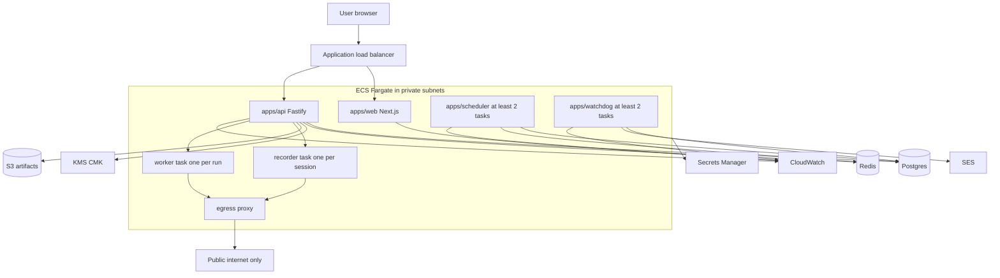

# Architecture

## System context

The user never opens a port to a recorder or worker. The browser talks only to the load balancer. A recorder or worker is a short-lived task that connects outbound to the API and to the egress proxy.

## Trust boundaries

| Boundary | Who is inside | What must not cross it |
| --- | --- | --- |
| Browser to API | Session cookie, WebSocket | Another tenant's ids, even if guessed |
| API to Postgres | Per-request `SET LOCAL app.tenant_id` | Queries without a tenant on the request path |
| API to recorder/worker | One-run token, already-decrypted secrets for that run only | Database URL, KMS decrypt, other tenants' secrets |
| Chromium to network | Egress proxy | RFC1918, link-local, localhost, `169.254.169.254`, ECS task metadata `169.254.170.2` |
| Watchdog to SES | Redacted notification payload | Credentials, cookies, `storageState`, raw page text |

Service processes (scheduler, watchdog, dispatcher) use a database role that can read and update run and notification rows across tenants. That role is not used by request handlers. Request handlers use a role that is subject to row-level security.

## Record

1. The user clicks Record. The API inserts a `browser_session` row, mints a one-time token, and starts a recorder task (or assigns a warm one) with that token and nothing else.
2. The task launches Chromium. The API opens a WebSocket to the task on the private network. The browser's WebSocket terminates at the API, which proxies frames and input. The browser never learns the task IP.
3. Video is a CDP screencast (JPEG). Input is forwarded as CDP mouse, keyboard, wheel, and insert-text events. Details and the noVNC comparison are in [recorder streaming](./04-recorder-streaming.md).
4. Capture scripts are installed with `context.addInitScript` and `page.exposeBinding`, so they survive navigations. Popups become new pages on the same context. Native dialogs are recorded through Playwright's dialog event. A file chooser becomes an `upload` step flagged `needs-file`; the OS file dialog is not remote-controlled.
5. Password field values are sent to the API vault and replaced with `{{credentials.password}}` before the step is stored or shown. The recorder process drops the plaintext after the API acknowledges the write.
6. Stop & Save writes the workflow JSON and a version row. `storageState` from the context is encrypted and stored. The task is destroyed.

## Run

1. "Run now" inserts a `runs` row (`trigger = manual`) and a BullMQ job whose id is `runId:attempt`.
2. A worker claims the job, starts a fresh browser context, loads encrypted `storageState` (decrypted by the API, delivered in the run grant), and replays steps.
3. Locators are tried in the order stored on the step. If a later locator works, the step result is `healed`.
4. Variables are rendered at step execution, in the workflow timezone: `{{today}}`, `{{today|FORMAT}}`, `{{now}}`, `{{weekday}}`, `{{credentials.*}}`, and user variables.
5. Assertions run as steps. All of them must pass.
6. The user may attach a live view. That is the same screencast path, read-only unless the run is a re-login session.
7. Artifacts (masked screenshots, optional video) go to S3 under `org/{orgId}/runs/{runId}/` via URLs the API minted for that prefix. The worker task role cannot list other prefixes.

## Schedule

The scheduler does not fire cron from memory.

1. Every 15 seconds each scheduler task runs the same loop. Claims use `SELECT … FOR UPDATE SKIP LOCKED`, so two tasks do not materialize or enqueue the same row.
2. The loop expands enabled cron expressions in the workflow timezone across the next 24 hours and inserts `runs` rows with `status = scheduled`. The unique key `(workflow_id, scheduled_for)` makes a slot exist at most once.
3. Due rows are moved to `queued` in the same kind of locked claim, then a BullMQ job is added. The job id is deterministic. If the process dies after the status flip and before the queue add, the next tick (or the watchdog) sees `queued` with no live job and adds it again.
4. Catch-up, overlap, and retries are specified in [email and reliability](./05-email-and-reliability.md).

## Re-login

If a run's URL or a recorded signal matches a login, MFA, SSO, or CAPTCHA page, the worker stops with `needs-login`, writes the outbox row, and keeps `storageState` as-is. "Re-login" starts a recorder task seeded with that state. When the user finishes, the new `storageState` replaces the old one. CAPTCHA is never solved by the runner. TOTP, if the user stored a secret, is a step the runner may fill with a generated code. SMS and push cannot be completed by the runner.

## What is shared vs copied

`packages/browser` holds locator fallback, variable rendering, and the replay interpreter. `apps/worker` and `apps/recorder` are thin entrypoints on the same image, different commands. Using one image is what makes a later self-hosted runner a config change (outbound queue poll, no inbound port) rather than a second codebase.

## Deviations from the brief, on purpose

- **Network idle after navigation is opt-in per step, default off.** Analytics and chat widgets keep connections open, so `networkidle` makes unrelated sites fail. The next step's locator auto-wait is the default synchronization. A step may set `wait: "networkidle"` when a portal actually goes quiet.
- **Notification collapse does not delete per-run outbox rows.** Tests can still require one queued row per failed run. Collapse merges sends, not records.
- **Business retries are not BullMQ attempts.** The queue retries a job only when a worker dies mid-attempt (stall). Whether that death becomes a new business attempt is decided from the attempt row and the commit-step flag, not from a blanket queue retry count.

## Phase 1 shape

Phase 1 is local Docker: one Postgres, one Redis, one recorder container, one worker container, a single hard-coded tenant, files on disk instead of S3, a local data key instead of KMS, and no SES. The workflow JSON schema and the replay interpreter should still match this document so Phase 2 does not rewrite them.
